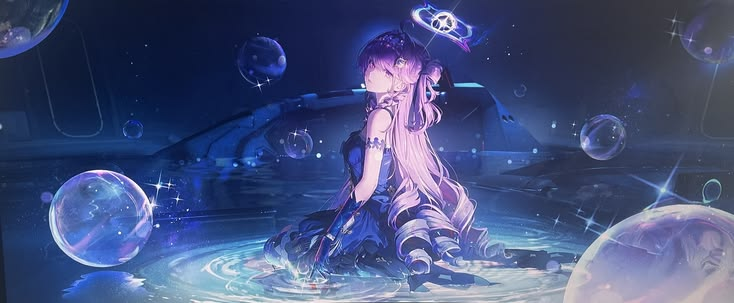
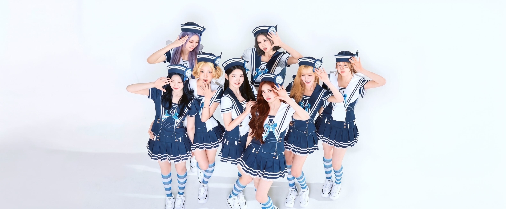

<!-- =========================================
     HANDIKA'S GITHUB PROFILE
     Soft Anime × Clean Developer
     Lavender • White • Amber
========================================== -->

<div align="center">

<!-- HERO BANNER -->


<br/>


<p>
<i>Thanks for visiting my little corner of the internet ♡</i>
</p>


</div>

---

<!-- ABOUT ME -->

<table>
<tr>
<td width="65%" valign="top">

```yaml ## ✦ About Me

Hi! I'm Handika, a student who enjoys exploring the world of programming, technology, and design.

- Currently learning programming.
- Interested in software development.
- Enjoy anime, music, and creative things.
- Always curious about how things work.
- Learning something new every day.

"Small steps, big changes."
```
</td>

<td width="100%" align="center" valign="middle">


**Handikakokekab**

<sub>Student • Developer • Dreamer •</sub>

</td>
</tr>
</table>

---

<!-- GITHUB OVERVIEW -->

## ✦ GitHub Overview

<div align="center">


</div>

---

<!-- CONTRIBUTION GRAPH -->

## ✦ Contribution Journey

<div align="center">


</div>

---

<!-- FEATURED PROJECTS -->

## ✦ Featured Projects

<div align="center">

<a href="https://github.com/Handikakokekab?tab=repositories">

</a>

</div>

<br/>

<table>
<tr>
<td width="50%" valign="top">

### Anime World

A personal space for anime information and collections.


</td>
<td width="50%" valign="top">

### Study Notes

My study notes, learning materials, and summaries.


</td>
</tr>
<tr>
<td width="50%" valign="top">

### Personal Portfolio

A personal website to showcase my work and progress.


</td>
<td width="50%" valign="top">

### Dev Tools

A collection of useful tools and experiments.


</td>
</tr>
</table>

---

<!-- SKILLS AND TOOLS -->

## ✦ Skills & Tools

<div align="center">

### Programming Languages


<br/><br/>

### Development Tools


<br/><br/>

### Currently Learning


</div>

---

<!-- FAVORITE MUSIC -->

## ♡ Favorite Music

<div align="center">



<br/>

<i>A little playlist for my everyday life ♡</i>

<br/><br/>

<table>
<tr>

<td align="center" width="33%">

<a href="https://open.spotify.com/search/Hearts2Hearts%20Lemon%20Tang">

</a>

<br/><br/>

**Lemon Tang**

<sub>Hearts2Hearts</sub>

<br/>

<a href="https://open.spotify.com/search/Hearts2Hearts%20Lemon%20Tang">

</a>

</td>

<td align="center" width="33%">

<a href="https://open.spotify.com/search/Hearts2Hearts%20RUDE">

</a>

<br/><br/>

**RUDE!**

<sub>Hearts2Hearts</sub>

<br/>

<a href="https://open.spotify.com/search/Hearts2Hearts%20RUDE">

</a>

</td>

<td align="center" width="33%">

<a href="https://open.spotify.com/search/Hearts2Hearts%20ICONIC%20HEART">

</a>

<br/><br/>

**ICONIC HEART**

<sub>Hearts2Hearts</sub>

<br/>

<a href="https://open.spotify.com/search/Hearts2Hearts%20ICONIC%20HEART">

</a>

</td>

</tr>
</table>

<br/>

<sub>♪ Currently on repeat — Hearts2Hearts ♡</sub>

</div>

---

<!-- CURRENT FOCUS -->

## ✦ Currently Exploring

<div align="center">

| Focus | Goal |
|:---|:---|
| Programming | Improve problem-solving skills |
| Algorithms | Understand DSA fundamentals |
| Projects | Build useful personal projects |
| Design | Create clean and functional interfaces |
| Open Source | Learn to contribute to projects |

</div>

---

<!-- LEARNING JOURNEY -->

## ✦ My Learning Journey

<div align="center">


<br/><br/>

<i>There is always something new to discover.</i>

</div>

---

<!-- QUOTE -->

<div align="center">


</div>

---

<!-- CONNECT -->

## ✦ Let's Connect!

<div align="center">

<a href="https://github.com/Handikakokekab">

</a>

<a href="https://www.instagram.com/cyliezy.ya/">

</a>

<br/>
<br/>

<br/><br/>
<i>Feel free to explore my repositories and projects.</i>

<br/>


<br/>

### Keep coding, keep dreaming! ✦

<sub>Thanks for scrolling all the way down ♡</sub>

<br/>

<sub>© 2026 Handikakokekab</sub>

</div>
