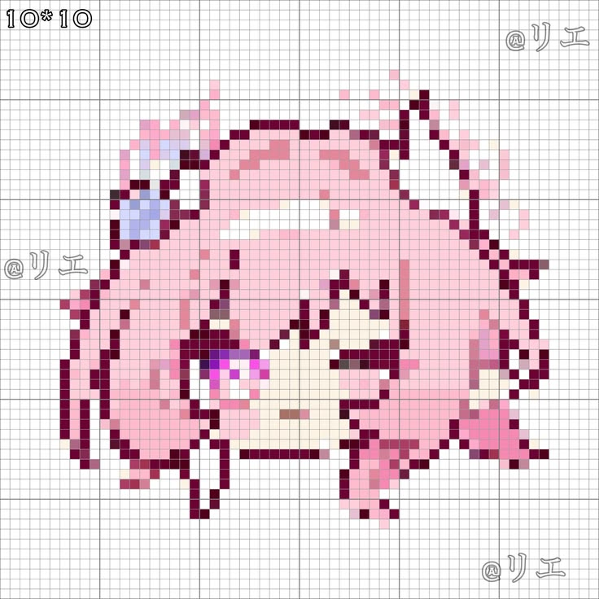
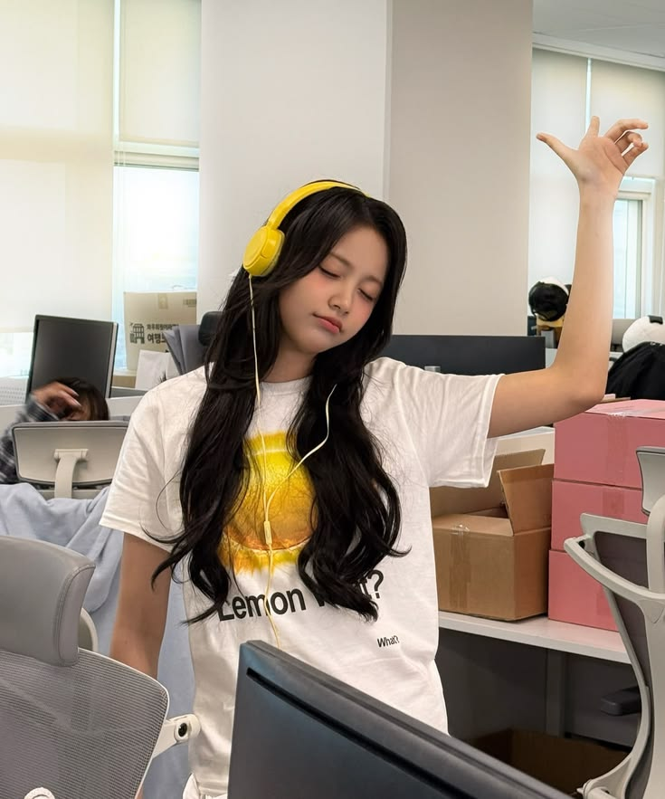

<div align="center">


# Hi, I'm Handika

### こんにちは、私のプロフィールへようこそ。

[][def]


</div>

## ✧ About Me



```yaml
Name: Handika
Interests:
  - Anime
  - Music
  - Technology
  - Football
Currently: Learning to code
Mindset: One step at a time.
```

<br clear="right"/>

## ❀ Tech Stack

<div align="center">


</div>

## 🎧 Now Playing

<div align="center">



### ♪ Music is my little escape.

`Lo-fi`　`J-Pop`　`Anime OST`

*Somewhere between music and imagination.*

</div>

## ✧ GitHub Stats

<div align="center">


<br/>


</div>

## 🌱 Contribution Garden

<div align="center">


</div>

## ♡ Little Pixel Corner

<div align="center">


`✦` `♡` `✧` `☁` `☆`

### 「自分のペースで進もう」

*Let's move at our own pace.*

Thanks for visiting my profile!


</div>


[def]: https://git.io/typing-svg
